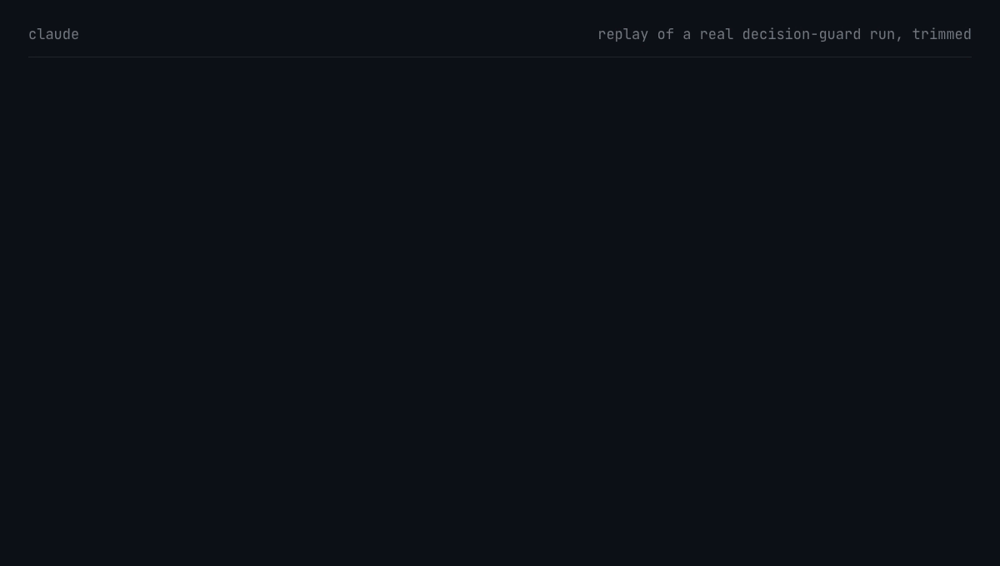

# decision-guard

[](LICENSE)
[](https://github.com/EcossAIah/decision-guard/releases)
[](https://www.python.org)
[](guards)
[](#install)
[](#how-it-works)

A Claude Code plugin that stops your agent from writing "we decided" when you didn't.

A decision model like [Jev](https://openrouter.ai/blog/insights/what-is-jev/) checks every new doc line against what you actually said. If you never decided it, the write is blocked.



That's a replay of a real run, trimmed. The guard blocked the first write, and the file wasn't touched. It passed the second, where the same two lines are honest proposals. The default model and Jev both blocked the same lines.

## Why this exists

You spend an hour planning with your agent. You push back on half of it, leave a few things open, say "maybe". Then you open the doc it wrote, and your maybes are in there as facts. "Decision: no auth in v1." "As agreed." Agreed by who? You said yes to one thing out of four and now all four are requirements.

Annoying once. Worse the next morning, when a new session reads that doc with no memory of the conversation. It has no way to know that line was a guess. So it builds on it, then writes more docs citing it. A week later you're arguing with a spec you supposedly wrote, and you can't remember which of those decisions were yours.

You can put a rule about this in CLAUDE.md, and the agent can ignore it. This is a hook, so it runs either way.

You've probably hit some version of this. From the Claude Code issue tracker:

- ["A hypothetical/exploratory discussion should not be persisted as an established fact."](https://github.com/anthropics/claude-code/issues/69847)
- ["...treated configuration values originating in pasted third-party material as though they were decisions I had made."](https://github.com/anthropics/claude-code/issues/95826)
- ["...a detailed fictional record of future events (including an approval the user never gave) into a persistent work-log file"](https://github.com/anthropics/claude-code/issues/88244)

decision-guard catches this when it lands in a doc: plans, specs, ADRs, CLAUDE.md, memory files, status files, anything `.md`, `.mdx`, `.txt`, `.rst` or `.org`. It doesn't stop an agent from faking approval to run a command, like a merge. It only guards what gets written down.

## How it works

This tool exists because of decision models. A decision model doesn't write text. You give it some state and typed questions, and it returns an answer with probabilities. That's the right shape for "did the user actually decide this?", and it's cheap enough to ask on every doc edit: Jev was listed at $0.042 per million input tokens, with free output, in October 2026.

1. The agent writes to a doc. The hook picks out only the new lines.
2. It sends those lines, plus your conversation, to a decision model. For each line it asks: does this claim a choice, did the user decide it, is it labelled as not decided, and did the user say or approve it?
3. If a line claims a choice you didn't make, the write is blocked, and the agent gets the list of lines and how to fix them: relabel them, or ask you.

Things you really decided pass. So do facts, code descriptions and anything labelled `Proposal:`, `Open:` or `Option:`. If a whole doc is the agent's own plan, one line near the top covers it: `Status: Agent proposal - not approved by the user`. Lines claiming you decided something are still checked.

### Pick your decision model

You aren't tied to one. Set any decision model on OpenRouter with `/plugin configure decision-guard@decision-guard`, for example `typesafe/jev-1.14`.

[Jev](https://openrouter.ai/rankings/decisions), from TypeSafe, was the first decision model on OpenRouter and is the most used: versions 1.13 and 1.14 rank first and second by requests (data through November 5, 2026). OpenRouter lists 21 decision models from 13 makers, and says most take a Jev request with only the model changed. We tested these four, through the real hook:

| Model | Made-up decisions caught | Honest lines wrongly blocked |
|---|---|---|
| `perplexity/pplx-decider-v1.2` (default) | 50 of 59 | 0 of 64 |
| `typesafe/jev-1.13` | 50 to 52 of 59 | 3 of 64 |
| `typesafe/jev-1.14` | 49 to 50 of 59 | 3 of 64 |
| `inception/mercury-decide` | 36 to 39 of 59 | 4 to 5 of 64 |

Decider is the default because it wrongly blocked nothing, and a wrong block interrupts real work. Take the gap lightly: the cases are invented, and our questions were first tuned on Decider, which may favour it. Tuning them for Jev is next.

## Numbers

50 of 59 made-up decisions caught, 0 of 64 honest lines blocked, with the default model. That's on [our benchmark](#benchmark) of invented conversations, so treat it as a rough guide.

What it misses most often is a "Yes." to a bundle of things, where the extra details get through. If OpenRouter is down or your key hits its spending cap, writes go through with a warning. More in [Known limits](#known-limits).

## Install

Requirements: Claude Code, Python 3.9+ (standard library only), macOS or Linux, an [OpenRouter](https://openrouter.ai) API key.

### As a plugin

```bash
claude plugin marketplace add EcossAIah/decision-guard
claude plugin install decision-guard@decision-guard
```

Then add your OpenRouter key, and pick a model if you like. Inside Claude Code, type:

```
/plugin configure decision-guard@decision-guard
```

The key goes in a masked box and is kept in your system's secure credential store. Use the same command to change it later.

At the start of each session the plugin checks its setup. It warns you if the key or Python is missing, or if the guard is also installed by hand (remove the old hook entries from `~/.claude/settings.json`, or every check runs and is paid for twice).

Updates are off by default for third-party plugins. Run `claude plugin update decision-guard@decision-guard`, or turn on auto-update in `/plugin`.

### By hand

```bash
mkdir -p ~/.claude/hooks/decision-guard
cp guards/decision_guard.py guards/judge.py ~/.claude/hooks/decision-guard/

mkdir -p ~/.config/decision-guard
echo 'OPENROUTER_API_KEY=sk-or-...' > ~/.config/decision-guard/.env
chmod 600 ~/.config/decision-guard/.env
```

Then merge the `hooks` section of [`settings.example.json`](settings.example.json) into `~/.claude/settings.json`.

## What it watches

| Claude Code tool | How |
|---|---|
| Write, Edit, MultiEdit | New lines judged before the write; blocked if they claim a decision you didn't make |
| NotebookEdit | Same, for text (markdown) cells only; code cells are not judged |
| Claude Docs (MCP) | Same, on the text sent. Lookups (`guide`, `read`, `query`, `export`, `delete`) write nothing and are not judged |
| Shell commands (Bash) | Doc files snapshotted before the command, diffed after; new lines traced to where their text came from, and only this session's judged (catches `python`, `sed`, `cat >` …) |
| Artifact publish | Page stripped to visible text; lines new since the last approved publish judged, with their heading as context |

Docs means `.md`, `.mdx`, `.txt`, `.rst`, `.org`. Claude Code's own storage under `~/.claude/projects` (saved pages, tool output) is skipped for every tool. Temp folders aren't skipped.

## Shell writes: whose text is it?

A doc changing while a shell command runs doesn't mean the agent wrote it. Git brings in committed text, downloads bring in outside text, and editors, other agents and sync tools write at the same time. So each new line is traced, and only this session's text is judged:

| Where the line's text came from | Judged? |
|---|---|
| This session typed it (echo, heredoc, a script it wrote, a patch) before anything else had it | yes |
| New words while this session's own code ran (inline `python -c`, `sed`/`awk`/`perl`, an AI CLI it drives, a script it wrote) | yes |
| Git history from before the command: switch, checkout, reset, restore, stash, merge, rebase, pull, clone, worktree | no |
| Another doc's earlier copy (`cp`, `mv`, scripts that merge files) | no |
| Another session typed it, and that session runs this guard (or its log existed before the command) | no (that session's guard judges it) |
| New text when only programs this session didn't write ran (`curl`, `npm`, `git`, a project's own scripts, an editor) | no |

- **Whole files first.** A doc that now equals, byte for byte, a version git had before the command (switch, reset, worktree add, pull) has no new writing in it, so its lines aren't checked one by one. This keeps a reset that brings in thousands of docs fast.
- **This session's own commits are never "history".** Commits that appear while any of the session's commands run (except fetched ones) are remembered for the whole session, whatever date they carry. Writing a line, committing it (even with git plumbing, on another branch) and bringing it back later is still judged.
- **Who had it first wins.** Text typed only in a search (`grep`, `git log`, `cat`) doesn't count as writing it. Calls a hook or the user denied don't count either. Lines under 16 characters are never credited to another session.
- **Decoded text counts.** Output of a decoder (`base64 -d`, `xxd -r`, `gunzip`, ...) or of anything fed this session's text through a pipe or heredoc, redirected into a doc, is judged.
- **Labels travel with the text.** A line copied from a doc labelled `Status: Agent proposal` into a doc without that label is judged.
- **Reformatting isn't writing.** Bullet style, bold, heading level, table padding and re-wrapping a paragraph don't count as new. Any changed word does, so stripping a `Proposal:` label is judged.
- **Commits made during the command don't count as history,** whatever date they carry (checked by which branches could reach them before the command). `sed ... && git commit` is still judged. Fetched commits (`git pull`) count.
- **Words handed to a tool count.** A project script or generator run with this session's words (`adr new "Use Postgres"`) has its new lines in that doc judged.
- **Where "typed" comes from:** the guard reads each session's own log (Claude Code writes every tool call there before the tool runs), plus its helper agents' logs. It keeps only fingerprints (hashes) of that text, not a copy.
- **Tools with no session log:** if a hook gets no log path (some other coding tools; see Known limits), the guard saves each tool call and user message itself, in `sessions/<session>/saved-calls.jsonl`, in the same format, and reads that instead. The tool must also send its prompt event (like `UserPromptSubmit`) to the guard, or the judge has no user messages and every check fails open. Claude Code never needs it.
- **Time:** the whole after-step ends by 82 s (Claude Code kills hooks at 90 s). Lines waiting to be judged are saved before judging, so a killed hook doesn't lose them.
- **One real collision:** new words appear in a file while this session's own code ran, and the code never names that file. If no other source has them, they're judged, but the agent is told not to edit them and to show the user instead.

## How the judge works

- A decision model (default `perplexity/pplx-decider-v1.2`, your choice with the plugin's `decision_model` setting, through OpenRouter's Decisions API) answers four yes/no questions per line: does it claim a choice; is it decided; is it labelled as not decided; did the user say or approve it.
- It sees the conversation from the session transcript, packed into 40,000 characters: all of the user's messages first (with the question each one answered), then recent context.
- If the judge **can't be reached** (network, service error, rate limit, missing key), the write goes through with a visible warning (fails open). Its lines go on a **to-be-judged list** and are checked after the next shell command.
- Judging stops at 70 seconds, before Claude Code's 90-second hook limit. If the judge had already answered part of a Write, the write is too big to check in time and is **blocked** ("write it in smaller pieces"). If it never answered, that counts as an outage.
- Secrets are scrubbed from each whole line before it is split into pieces, so a cut can't leave part of a key unscrubbed.
- If the judge **can't judge the content** (rejected request, malformed answer) or a write adds more than 600 lines to judge, the write is **blocked**: content must not be able to switch the check off.
- **Long lines** are split into pieces of about 1,000 characters, at sentence ends where possible. Every piece is judged, and each keeps the line's opening words and the document label. A line is blocked if any piece is.
- **Shell writes** are already on disk when the guard sees them. Lines it couldn't judge (judge down, rejected, over the limit, too slow) go on the to-be-judged list. They're retried after each later shell command, up to 3 times or 24 hours, then logged as `never_checked` with a warning. Lines fixed or deleted in the meantime are dropped.

## Settings

Environment variables:

| Variable | Default |
|---|---|
| `OPENROUTER_API_KEY` | used if the plugin has no key; read from the env file if not set |
| `DECISION_GUARD_ENV_FILE` | `~/.config/decision-guard/.env` |
| `DECISION_GUARD_MODEL` | the plugin's `decision_model` setting, or `perplexity/pplx-decider-v1.2` |
| `DECISION_GUARD_ENDPOINT` | OpenRouter's Decisions API (change for a proxy or tests) |
| `DECISION_GUARD_STATE` | the plugin's data folder, or `~/.claude/hooks/.decision-guard` for a manual install (state and log folder; change for tests) |

`log.jsonl` in that folder lists every judged run and flagged line. A plugin install's folder is `~/.claude/plugins/data/decision-guard-decision-guard/`.

## Privacy and cost

- New doc lines and the packed conversation are **sent to OpenRouter** and the model provider. The request asks providers not to keep data (`data_collection: deny`).
- Common secret formats (API keys, tokens, passwords, private keys) are scrubbed before sending.
- You pay with your own OpenRouter key. The model is only called when doc lines are new; a hook run with nothing new (most shell commands) costs nothing.
- Every paid run is logged with its cost, number of API calls, seconds and file paths, including runs that stop partway. See where the money goes: `python3 guards/cost_report.py --days 7` from a copy of this repo (by day, trigger, file, session; big runs listed first).
- Tip: a daily spending cap on the OpenRouter key limits surprises, but hitting it makes the guard fail open (writes go through unchecked) until it resets.

## Tests

```bash
python3 -W ignore tests/test_trace.py
python3 -W ignore tests/test_trace_redteam.py
python3 -W ignore tests/test_cost.py
python3 -W ignore tests/test_plugin.py
python3 -W ignore tests/test_answers.py
```

`test_answers.py` checks that question-box answers reach the model in every wording Claude Code uses, that long answers are kept whole, and that a refused question box or another tool's output never counts as an answer.

`test_cost.py` checks that unneeded judge calls are skipped (Docs lookups, notebook code cells, Claude's own storage) while real docs are still judged, and that paid calls are logged even when judging fails partway.

Runs real shell commands (git, curl, sed, python) between the guard's before and after steps, with the judge replaced by a recorder. One test per row of the shell-writes table, plus the clashes above. The red-team file holds the cases a separate reviewer found (crashes on file names with spaces, scripts made with heredocs, backdated commits, downloads piped through `jq`, speed with long sessions and many git refs).

Real-session test: `tests/practical.py` runs 7 scenarios in real headless Claude Code sessions with the real judge. It fails a run unless the guard's after-step is proven to have finished. Scenarios 1-3 need your own big repo, set with `DG_TEST_BIG_REPO`, `DG_TEST_BIG_BRANCH`, `DG_TEST_BIG_START` and `DG_TEST_BIG_DOC`; they are skipped without it.

Test sessions get only the shell and file-write tools, a fixed list of allowed commands, and file edits inside the test folder (`acceptEdits`; shell appends count as edits). Anything else is refused. The test sessions run on the Claude subscription; the only paid part is the judge.

Last full real-session run: 2026-11-07 on the 0.2.0 code with the default model, 13 of 13 pass, through the manual hook command. The plugin install (key and model reaching the hook, a bad line blocked, the missing-key warning) was tested from GitHub with a fake key and a fake judge. Tested on one Mac; not on Linux.

## Benchmark

```bash
python3 bench/hook_bench.py --runs 3
```

This sends each test case through the **real hook program**, the same way a live Write reaches it, and counts which lines it blocks.

Results on the published cases (123 labelled lines, 3 runs) are in [Pick your decision model](#pick-your-decision-model). To test another model, set `DECISION_GUARD_MODEL`.

The default model scored 54 of 59 before version 0.2.0, when each line was written into the question. Jev caught only about 20 that way. Sending the lines as state took Jev to about 50 and Decider to 50, with no wrong blocks, so one format now works across models.

**The cases** (`bench/cases/`):
- `patterns.json`: 15 patterns of false decisions seen in real use (bundled yes, unanswered questions, agent defaults, recommendations written as plans, invented attributions, reworded choices, agent fixes saved as rules, status-file guesses) plus honest controls. Topics and wording are invented; only the shape of each conversation is kept.
- `synthetic.json`: 10 trap cases. `neutral.json`: facts, code descriptions and quotes that must pass.
- `long.json`: 6 generated long conversations (2K–24K tokens), with the user's decision at the start or in the middle.

**What the default model misses:** extra lines under a bundled "Yes." (5 of the 9), such as a detail the agent tied to an approved choice ("free tier" approved, "plain text only, no images" added), a recommendation written into a plan, an invented blocker in a status file, a rejection the user never made, and one confident statement under a "nothing decided yet" heading.

**Limits:** these are invented conversations, mostly short. The score depends on wording: an earlier wording of the same 15 patterns scored 93% (false decisions caught 51/59), with misses on a bare "Yes." to a bundle and on unanswered questions recorded as settled. The score says how this code separates false decisions from honest lines on these cases. It does not promise the same accuracy on your sessions.

`bench/bench.py` runs the judge alone (no hook) and can compare models and modes.

## Known limits

- **Earlier sessions:** the guard sees only the current session. A decision made in an earlier session gets flagged unless the line cites where it was recorded.
- **Bundled yes:** "Yes." to several proposals is the hardest case, and some still get through.
- **Firmness:** the judge checks whether the user said something, not how firmly. Hedged words ("I'm thinking we use Postgres", "my first instinct is to skip caching") can pass as a decision, even in a line marked final.
- **Very long sessions:** if the user's own messages alone exceed the 40,000-character budget, the oldest drop out.
- **Fail-open on outages:** a model or network outage means writes go through with a warning. They're checked later only if the session runs another shell command, and only after it runs (by then the lines are already in the file).
- **Cloud sessions:** Claude Code cloud sessions don't load plugins from your local settings, so this plugin won't run there. Not tested in the cloud.
- **One provider:** any decision model works if OpenRouter carries it, through its Decisions API, which is labelled alpha. Other providers, and your own local models, aren't supported yet. A mistyped model name blocks doc writes with a message saying so, until you fix it.
- **Other coding tools:** built and tested for Claude Code. The saved-log fallback is ready for tools that give no log, but each tool (Codex, Gemini CLI, Cursor, Copilot, ...) still needs a small adapter for its own field and tool names. Codex 0.165 `codex exec` fired no before/after-tool hooks for shell commands in a test (2026-11-04).
- **Deliberate forgery:** the guard defends against an agent drifting, not one attacking the guard. An agent that writes fake session logs or fake guard state in an earlier command can make its text look like another session's.
- **Big writes:** a Write/Edit with more than 600 pieces to judge (lines, with long lines counting once per 1,000 characters) is blocked; write large docs in pieces. A shell write that big is judged 600 pieces per command.

## License

[Apache 2.0](LICENSE)
